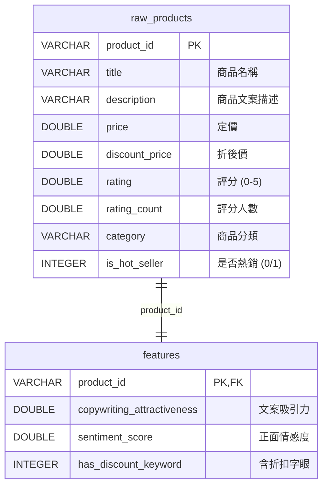
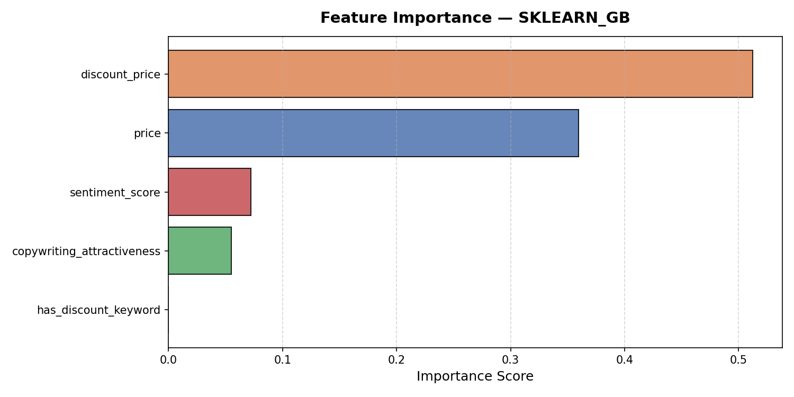
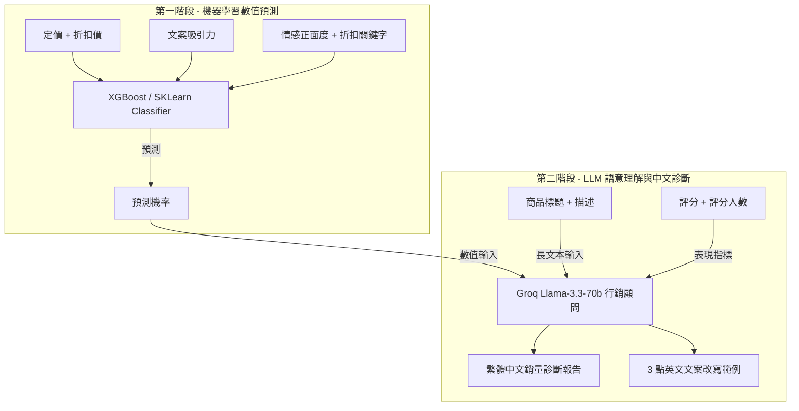
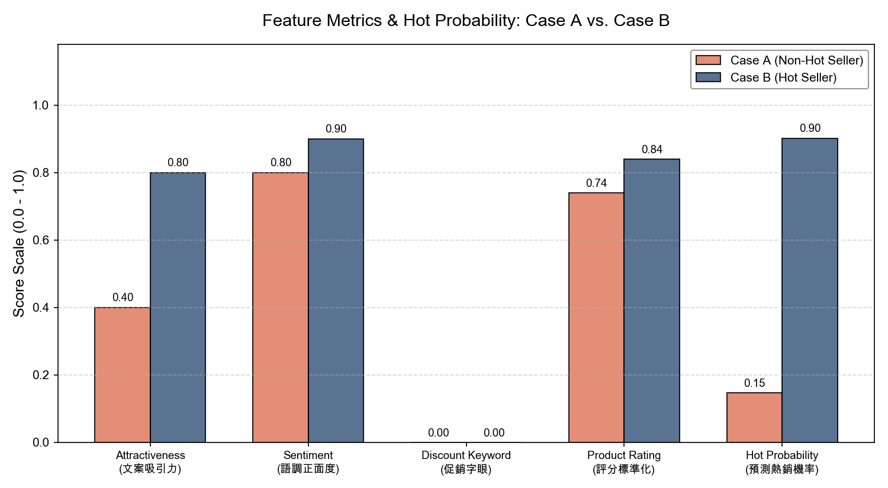

# 專案一｜電商商品熱銷預測與 AI 文案診斷系統

[← 回到總覽](../README.md)

> 用 LLM 把非結構化的商品文案轉成結構化特徵，結合機器學習預測商品熱銷潛力，再由 LLM 產出可執行的繁體中文診斷報告。

**Notebook：** `01_etl.ipynb` ~ `04_explain.ipynb`

---

## 一、核心概念與痛點

在電子商務中，商品文案（標題與描述）是影響消費者下單的關鍵，但這些非結構化的長文本傳統上難以直接作為特徵輸入機器學習模型。

本專案利用 **LLM 作為非結構化特徵的提取器**，自動將文案語意轉化為數值指標，並結合商品本身的數值特徵（定價、評分等），訓練機器學習分類器預測商品的熱銷潛力。最後，透過 LLM 作為行銷顧問，自動產出可立即執行的**繁體中文文案優化診斷報告**。

## 二、技術架構

```
Amazon 商品原始數據 (Kaggle)
   ↓ (01_etl.ipynb)
價格/評分清洗、熱銷標籤定義 ➡️ 載入 DuckDB 數據庫 (ecommerce.db)
   ↓ (02_llm_features.ipynb)
呼叫 Groq API (Llama-3.3-70b) ➡️ 萃取「吸引力、正面度、含折扣字眼」特徵
   ↓ (03_train.ipynb)
結合數值特徵與 LLM 語意特徵 ➡️ 訓練 XGBoost/GradientBoosting 模型 (Accuracy 83%)
   ↓ (04_explain.ipynb)
模型預測機率 + LLM 行銷顧問 ➡️ 繁體中文診斷報告 + 商品特徵視覺化
```

## 三、DuckDB 資料庫結構



---

## 四、Notebook 實作細節

### [01_etl.ipynb｜資料 ETL 與 DuckDB 整合](../01_etl.ipynb)
- **透過 Kaggle API 下載資料**：自動下載 `karkavelrajaj/amazon-sales-dataset`。
- **資料清洗與熱銷標籤定義**：
  - 清洗貨幣符號（如 `₹`）並將價格轉為 `DOUBLE`，平滑與填補評分人數 (`rating_count`)。
  - 將**評分人數高於中位數且評分高於平均值**的商品標記為 `is_hot_seller = 1`。
- **寫入 DuckDB**：建立 `raw_products` 與 `features` 兩張表，為後續特徵融合提供關聯式查詢。

### [02_llm_features.ipynb｜LLM 非結構化特徵提取](../02_llm_features.ipynb)
- **Prompt 設計**：採用嚴格的 JSON Output 限制，要求 LLM 僅回傳 `copywriting_attractiveness`、`sentiment_score`、`has_discount_keyword` 三個 key。
  1. **文案吸引力**：判斷文案是否生動、具說服力，給出 `0.0~1.0` 評分。
  2. **情感正面度**：分析語氣，強烈推薦為 `1.0`，平淡或負面則較低。
  3. **折扣字眼**：理解文義，判斷是否包含 sale、discount 等概念（0 或 1）。
- **API 異常處理**：內建指數型退避重試（Exponential Backoff），遇到免費 API 限額 (`429`) 時自動暫停，最多重試 3 次。
- **批次萃取**：呼叫 Groq 的 `llama-3.3-70b-versatile`，將解析成功的特徵寫入 DuckDB 的 `features` 表。

### [03_train.ipynb｜XGBoost 熱銷分類模型訓練](../03_train.ipynb)
- **資料與特徵**：以 SQL JOIN 合併 `raw_products` 與 `features`；數值特徵加上 3 個 LLM 特徵；依 80/20 分層切分 (`stratify=y`)。
- **模型**：XGBoost（`n_estimators=150`, `max_depth=4`, `learning_rate=0.07`，樣本與特徵各抽樣 80% 防止過度擬合）。若 macOS 缺少 OpenMP，自動 fallback 為 sklearn 的 `GradientBoostingClassifier`。
- **評估指標**：

| 指標 | 數值 |
|---|---|
| Accuracy | 83.1% |
| ROC-AUC | 0.938 |
| Recall（熱銷） | 88.9% |

- **特徵重要性**：

  

  折扣價與定價仍是最主要的因素，但 LLM 萃取的「情感正面度」與「文案吸引力」同樣提供了不可忽視的預測貢獻。

### [04_explain.ipynb｜LLM 銷量診斷報告與對比圖表](../04_explain.ipynb)
解決機器學習「黑盒子」的問題，把預測數字翻譯成具體的行銷決策：



- 選取模型預測「非熱銷 (Case A)」與「熱銷 (Case B)」兩組對照案例，由 LLM 同時讀取文字與數字，說明熱銷機率、指出文案優缺點，並給出 3 點可直接使用的英文改寫範例。

  

  Case B（熱銷品）在「文案吸引力」與「語調正面度」上明顯高於 Case A（非熱銷品），模型也給出較高的預測機率。

---

## 五、如何執行

環境與 API Key 設定請見[總覽的快速開始](../README.md#快速開始)。依序執行：

```
01_etl.ipynb               下載 Amazon 商品資料，清洗並存入 DuckDB (ecommerce.db)
   ↓
02_llm_features.ipynb      呼叫 Groq API，萃取 LLM 特徵並儲存
   ↓
03_train.ipynb             結合數值與 LLM 特徵，訓練並儲存熱銷模型
   ↓
04_explain.ipynb           預測機率並由 Groq 生成中文診斷報告與圖表
```

