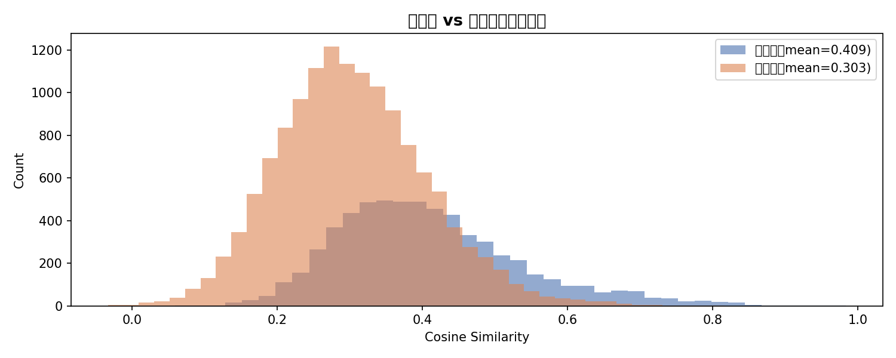

# 專案二｜語意搜尋與內容推薦系統

[← 回到總覽](../README.md)

> 用 Sentence Transformer 把商品映射到語意空間，以 Cosine Similarity 做推薦，不需要任何歷史交易資料，解決新商品與新用戶的冷啟動問題。

**Notebook：** [`05_semantic_recommendation.ipynb`](../05_semantic_recommendation.ipynb)（可獨立執行）

---

## 一、核心概念與痛點

傳統電商推薦（如協同過濾）高度依賴使用者的歷史瀏覽與購買紀錄，新商品上架或新用戶來訪時會面臨嚴重的**冷啟動 (Cold-Start)** 問題。

本專案實作**語意搜尋推薦**：把商品的「標題 + 描述」映射到 768 維的連續語意空間，再用 Cosine Similarity 衡量商品間的語意距離，**無須任何歷史交易資料即可推薦**。

## 二、技術架構

```
商品描述 + 標題 ➡️ paraphrase-multilingual-mpnet-base-v2 ➡️ 768 維 Embedding 向量 (npy)
                                                                  ↓
Query / 輸入商品 ➡️ 向量轉換 ➡️ 計算 Cosine Similarity ➡️ 輸出語意相似度 Top-K 推薦商品
```

## 三、實作成果

### 推薦指標

| 指標 | 數值 |
|---|---|
| Precision@3 | 0.950 |
| Precision@5 | 0.958 |
| Precision@10 | 0.964 |

### 語意相似度分佈



上圖比較「同類別商品對」與「跨類別商品對」的相似度：類別內平均 0.413，類別間平均 0.291。兩個分佈有明顯重疊，所以平均值的差距不代表能完全分開；但類別內的分佈在 0.6 以上有較長的高分尾巴，取 Top-K 最相似商品時，較容易選到同類別的商品。

### 跨品牌推薦驗證

查詢 "Wireless Mouse"（無線滑鼠）時，能推薦不同品牌（Logitech、Dell、HP、Amazon Basics）且屬性相近的滑鼠，展現語意泛化與對齊能力。

---

## 四、如何執行

環境設定請見[總覽的快速開始](../README.md#快速開始)。本專案獨立於專案一，可直接開啟 `05_semantic_recommendation.ipynb` 執行。
