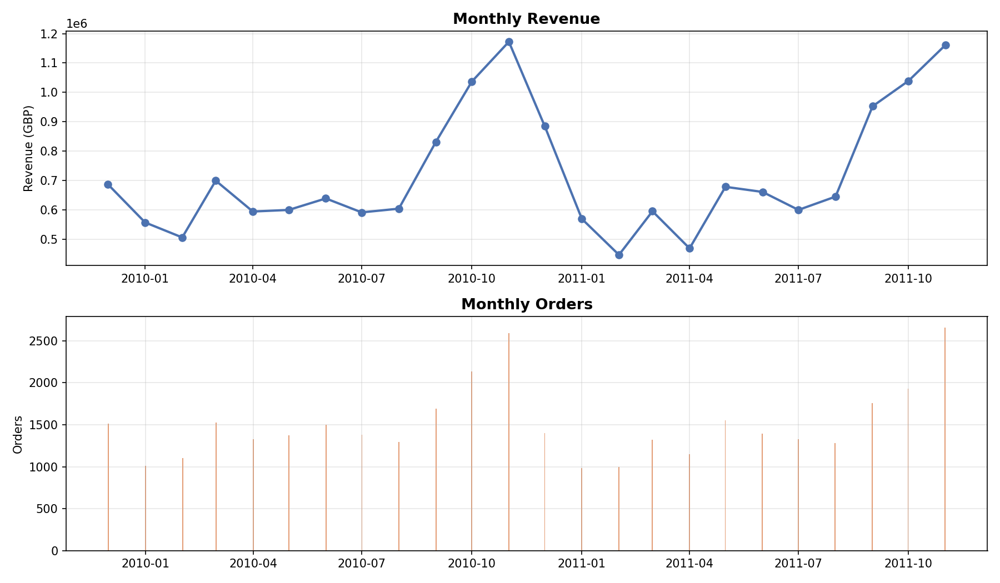
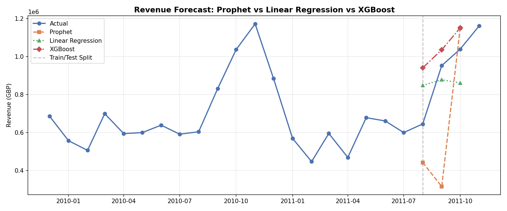

# 專案三｜英國電商時間序列銷售預測

[← 回到總覽](../README.md)

> 以月度營收為對象，比較 Linear Regression、Prophet、XGBoost 三種預測模型；加入 Lag 特徵後，XGBoost 的 MAPE 降到 0.8%。

**Notebook：** [`06_timeseries_forecast.ipynb`](../06_timeseries_forecast.ipynb)（可獨立執行）

---

## 一、核心概念與痛點

銷量與營收預測是供應鏈管理與庫存備貨的重點。本專案採用英國電商經典的 **Online Retail II 資料集**（包含 25 個月、80 萬筆真實跨境訂單），進行月度營收聚合，並比較三種預測模型的表現：

1. **Linear Regression**：作為 Baseline。
2. **Prophet（Meta）**：捕捉長期趨勢與季節性。
3. **XGBoost Regressor**：利用時間延遲特徵 (Lag Features) 捕捉複雜的非線性關係。

## 二、實作細節與多模型對比視覺化

### 月度銷售歷史趨勢（25 個月）

### Prophet 擬合與預測（含趨勢、季節性成分拆解與信賴區間）

### 三種模型預測精準度對比

## 三、預測指標與模型分析

| 模型 | MAPE | MAE | 適用場景與限制 |
|---|---|---|---|
| **XGBoost（含 Lag 特徵）** | **0.8%** | **8,704 GBP** | 加入 Lag 1、Lag 2 後表現最佳 |
| Linear Regression | 17.4% | 188,694 GBP | 簡單快速，適合歷史規律極穩定時 |
| Prophet | 36.3% | 316,826 GBP | 適合小資料集、有強烈年／週季節性的可解釋分析 |

**模型決策分析**：歷史營收只有 25 個月，資料點較少，因此不適合採用 LSTM 等深度學習網路（通常需要數百個以上時間點）。透過特徵工程建立 Lag 1 與 Lag 2 延遲特徵，XGBoost 能直接學到前幾個月的營收關聯，將 MAPE 降到 0.8%。

---

## 四、相關專案

同一份 Online Retail II 訂單資料的清洗、星狀模型與 Airflow 排程，見[專案四：電商訂單 ETL Pipeline](project4_orders_etl_airflow.md)。

## 五、如何執行

環境設定請見[總覽的快速開始](../README.md#快速開始)。本專案獨立於其他專案，可直接開啟 `06_timeseries_forecast.ipynb` 執行。

