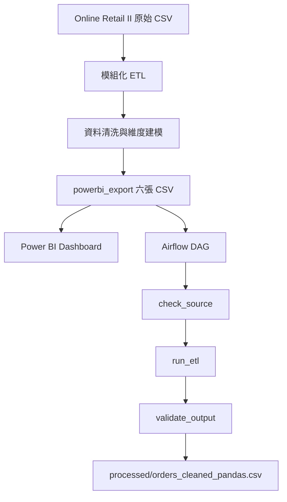

# 專案四｜電商訂單 ETL Pipeline（Airflow）與 Power BI Dashboard

[← 回到專案總覽](../README.md)

以 Online Retail II 訂單資料為主，建立從資料清洗、資料建模、排程處理到 BI 視覺化的完整流程。使用 Python 與 Pandas 建立模組化 ETL，將清洗後的資料整理成適合分析的資料表，再透過 Apache Airflow 執行自動化 Pipeline，並以 Power BI 呈現營收、訂單及市場表現。

**技術棧：** Python、Pandas、Apache Airflow、Power BI、DAX

## 專案成果

| 項目 | 實作內容 |
|---|---|
| 資料清洗與建模 | 模組化 ETL、資料品質統計、六張 CSV 資料表 |
| Airflow Pipeline | 三個依序執行的 Tasks、來源檢查、輸出驗證、失敗重試 |
| 資料驗證 | 筆數、營收總額、欄位及日期格式檢查 |
| 實測規模 | 1,041,670 筆訂單明細 |
| 執行效能 | 單次 ETL 約 8 秒，完整 Pipeline 約 15 秒 |
| Power BI | 兩頁 Dashboard、DAX 營運指標 |

---

## 一、整體架構

專案分成三個部分：

1. **資料清洗與建模：** 將原始訂單資料轉換成適合分析的資料表。
2. **排程與驗證：** 使用 Airflow 串接資料檢查、ETL 執行及輸出驗證。
3. **營運視覺化：** 使用 Power BI 建立營收趨勢、市場比較及商品分析 Dashboard。

其中，Airflow Pipeline 以 `fact_orders.csv` 作為輸入，負責後續的資料處理與驗證；Power BI 則使用 `powerbi_export/` 中的資料表建立報表。

## 二、資料清洗與建模

### 2.1 模組化 ETL

將資料處理拆分為 `extract.py`、`transform.py` 與 `load.py`，由 `main.py` 統一串接，讓資料讀取、轉換及輸出各自負責明確的工作。

ETL 直接讀取原始 CSV，不依賴 DuckDB 或 Notebook 的中間產物，因此可以獨立執行與重新產生輸出。

### 2.2 資料清洗規則

使用 `transform_orders` 處理訂單資料，主要規則如下：

- 排除無法解析日期的資料。
- 排除發票編號以 `C` 開頭的取消或退貨交易。
- 排除數量或單價小於等於零的資料。
- 新增 `Revenue` 欄位，以數量乘以單價計算營收。
- 分別統計各類被排除的資料筆數與原因，方便追蹤清洗前後的資料變化。

此階段以建立可供營收分析的銷售資料為目的；排除取消與非正數交易後的營收，不等同於包含退貨調整的淨營收。

### 2.3 輸出資料表

清洗後的資料輸出至 `data/powerbi_export/`，共六張 CSV：

| 資料表 | 內容 |
|---|---|
| `fact_orders.csv` | 清洗後的訂單明細 |
| `fact_monthly_revenue.csv` | 月度營收、訂單數、客戶數及客單價 |
| `dim_date.csv` | 日期、年份、月份及季度等日期維度 |
| `dim_product.csv` | 商品維度 |
| `dim_country.csv` | 國家維度 |
| `fact_products.csv` | Amazon 商品資料與熱銷標籤，沿用專案一的定義 |

其中，訂單相關資料用於本專案的 Power BI Dashboard；`fact_products.csv` 則屬於專案一的商品分析資料，不與訂單資料混合建模。

---

## 三、Airflow 自動化 ETL Pipeline

### 3.1 從 Notebook 重構為可排程的 Python 程式

將原先 Notebook 中的 Pandas ETL 整理成可獨立執行的函式，並由 Airflow DAG 管理任務順序、排程與失敗重試。

| 檔案 | 職責 |
|---|---|
| `08_etl_pandas.ipynb` | Pandas ETL 原型與實驗紀錄 |
| `etl_pandas.py` | 資料檢查、轉換、輸出及驗證邏輯 |
| `dags/ecommerce_etl.py` | DAG 定義、Task 依賴、排程及重試設定 |

將資料處理邏輯與 DAG 分離，讓 ETL 可以透過 `python etl_pandas.py` 獨立執行，不必啟動 Airflow 才能測試資料處理功能。

### 3.2 Task 設計

Pipeline 由三個依序執行的 Tasks 組成：

**`check_source`｜來源檢查**

確認來源檔案存在、內容非空，並檢查九個必要欄位。若來源不符合要求，Task 直接失敗，避免錯誤資料進入後續流程。

**`run_etl`｜資料處理**

執行資料型別轉換、商品描述清理及欄位名稱調整，將 `Revenue` 統一改為小寫 `revenue`，再輸出至 `data/processed/orders_cleaned_pandas.csv`。

**`validate_output`｜輸出驗證**

重新讀取輸出檔，檢查資料筆數、營收總額、必要欄位及日期解析結果。若驗證不通過，Task 會失敗，避免將未通過驗證的結果視為成功產出。

另外，Pipeline 會記錄完全重複的資料列、非正數數量、負單價及負營收等情況。這些檢查目前以警告方式記錄，不會直接中斷流程；是否需要排除，仍應依資料來源與業務規則判斷。

### 3.3 實測結果

| 驗證項目 | 實測結果 |
|---|---:|
| 輸入資料筆數 | 1,041,670 |
| 輸出資料筆數 | 1,041,670 |
| 營收總額 | 約 20,972,594.568 |
| 缺少 `customer_id` | 236,121 筆 |
| 缺少 `description` | 0 筆 |
| 完全重複的資料列 | 33,757 筆 |
| `quantity <= 0` | 0 筆 |
| 負單價、負營收 | 0 筆 |
| `run_etl` 執行時間 | 約 8 秒 |
| 完整 Pipeline 執行時間 | 約 15 秒 |

營收總額與先前的 DuckDB ETL 結果交叉比對一致。由於上游 ETL 已排除取消交易及非正數數量、單價，因此此階段的負值檢查結果為零，並不代表原始資料不存在退貨。

### 3.4 資料品質與失敗處理

**結構性錯誤與資料異常採取不同處理方式。**

- **結構性錯誤：** 來源檔缺失、必要欄位不足或輸出驗證不一致時，讓 Task 失敗，避免錯誤結果繼續流入後續流程。
- **資料異常：** 重複資料列及其他可能具有業務意義的異常先記錄，不在缺乏判斷依據時直接刪除。
- **安全重跑：** 每次執行覆寫指定輸出檔，避免單純重跑就持續累積資料。
- **數值驗證：** 使用 `math.isclose` 比較營收總額，避免浮點數運算的微小差異造成不必要的驗證失敗。

**失敗情境測試**

1. 暫時移除來源檔並觸發 Pipeline，確認 `check_source` 失敗，後續 Tasks 不執行，原有輸出檔不被覆蓋。
2. 還原來源檔並重新執行，確認三個 Tasks 依序成功。
3. 測試排程自動觸發，確認不需要人工逐一啟動各個步驟。

目前完成的是本機單機環境的 Airflow 排程與重試測試，尚未將其描述為正式生產環境部署。

---

## 四、Power BI Dashboard

使用 `data/powerbi_export/` 中的訂單資料建立兩頁 Dashboard，將 ETL 產出的資料轉換成可供營運分析的指標。

### 4.1 核心指標

使用 DAX 建立以下量值：

- **總營收：** 清洗後訂單明細的營收總和。
- **訂單數：** 不重複發票數。
- **客戶數：** 不重複客戶數。
- **客單價：** 總營收除以訂單數。

客單價使用整體總營收除以整體訂單數，而不是直接平均各月份的客單價，避免不同月份訂單量差異影響結果。

### 4.2 Dashboard 頁面

**第一頁｜營運總覽**

- 四張 KPI 卡片：總營收、訂單數、客戶數及客單價。
- 月營收趨勢：呈現 25 個月份的營收變化。
- 國家營收排名：依總營收排序，呈現前十名市場。

**第二頁｜商品與市場**

- 商品營收前十名。
- 市場分布視覺化：【待填：實際完成的圖表，地圖或排除英國的樹狀圖】
- 月份 × 國家營收矩陣，觀察不同市場的月度營收變化。

### 4.3 主要分析觀察

- **營收趨勢：** 2010 年及 2011 年的 11 月皆為營收高峰，呈現年末旺季特徵。2011 年 12 月資料不完整，不直接將當月營收下降解讀為業績衰退。
- **市場分布：** 營收主要集中於英國，其餘主要市場包括 EIRE、荷蘭、德國及法國。
- **資料口徑：** 目前營收統計仍包含未刪除的完全重複資料列，因此指標反映的是現行 ETL 規則下的計算結果，解讀時需考量此限制。

### 4.4 資料模型與視覺化設計

- **月份趨勢：** 使用 `year_month` 作為月份顯示欄位，並確保依時間順序排序，避免月份被自動彙總至年度層級。
- **排名依據：** 商品及國家前十名均依總營收排序。
- **商品分析：** 商品名稱直接使用 `fact_orders[description]`。以 `stock_code` 連接 `dim_product` 時，Power BI 判定為多對多，因此不建立這條關聯。
- **日期分析：** 月份 × 國家矩陣使用由訂單日期衍生的月份欄位。`order_date` 帶有時間，與 `dim_date` 的整日日期無法對應，因此不經由 `dim_date`。

---

## 五、專案重點

本專案整合資料工程與 BI 分析的實作流程：

- 以模組化 Python ETL 處理原始資料、清洗異常並建立分析資料表。
- 以 Airflow 管理任務依賴、排程執行、失敗重試及輸出驗證。
- 透過筆數、營收與欄位檢查驗證資料處理結果。
- 使用 Power BI 與 DAX 建立營運指標，將清洗後資料轉換為可供分析的 Dashboard。

