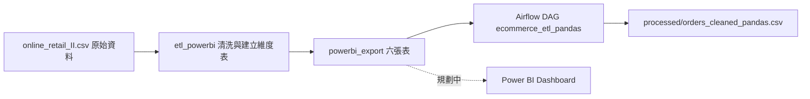

# 專案四｜電商訂單 ETL Pipeline（Airflow）與 Power BI 資料模型

[← 回到總覽](../README.md)

> 以 Online Retail II 訂單資料為主軸：原始 CSV 先經模組化 ETL 清洗成適合 BI 使用的星狀資料模型，再由 **Airflow** 排程執行「來源檢查 → 清理 → 輸出驗證」。同一份訂單資料的營收預測見[專案三](project3_timeseries_forecast.md)。

| 項目 | 狀態 |
|---|---|
| 資料清洗與星狀模型匯出（`etl_powerbi/`） | ✅ 完成 |
| Airflow 排程 Pipeline（`dags/`、`etl_pandas.py`） | ✅ 完成（本機單機環境） |
| Power BI 資料模型 | ✅ 資料已就緒 |
| Power BI Dashboard | 🔜 規劃中（見第四節） |

---

## 一、整體資料流



| 階段 | 程式 | 輸入 → 輸出 |
|---|---|---|
| 一、清洗與建模 | `etl_powerbi/` | 原始 CSV → `data/powerbi_export/` 六張表 |
| 二、排程與驗證 | `etl_pandas.py` + `dags/ecommerce_etl.py` | `fact_orders.csv` → `data/processed/orders_cleaned_pandas.csv` |

---

## 二、階段一：資料清洗與建模（`etl_powerbi/`）

模組化的 ETL，拆成 `extract.py`、`transform.py`、`load.py`，由 `main.py` 串接。

**設計重點**
- **直接讀原始 CSV**：不依賴 DuckDB 或 Notebook 的中間產物，讓 ETL 可以獨立重跑。
- **每一種被剔除的髒資料各自計數、各自記錄原因**，在流程結束時統一輸出摘要，資料量大時才查得出是哪個環節篩掉了什麼。

**清洗規則（`transform_orders`）**

| 規則 | 說明 |
|---|---|
| 日期解析失敗 | 剔除 |
| `Invoice` 開頭為 `C` | 退貨／取消訂單，剔除 |
| `Quantity <= 0` 或 `Price <= 0` | 視為異常或測試資料，剔除 |
| 新增 `Revenue` | `Quantity × Price` |

**輸出六張表**（`data/powerbi_export/`）

| 檔案 | 內容 | 來源 |
|---|---|---|
| `fact_orders.csv` | 訂單明細（已清洗） | Online Retail II |
| `fact_monthly_revenue.csv` | 月度營收、訂單數、客戶數、客單價 | Online Retail II |
| `dim_date.csv` | 日期維度（年、月、季） | Online Retail II |
| `dim_product.csv` | 商品維度 | Online Retail II |
| `dim_country.csv` | 國家維度 | Online Retail II |
| `fact_products.csv` | 商品與熱銷標籤（同[專案一](project1_llm_hot_seller.md)的定義） | Amazon |

執行（在專案根目錄）：

```bash
python -m etl_powerbi.main
```

---

## 三、階段二：Airflow 排程 Pipeline

把 Notebook 裡的 Pandas ETL 重構成可被排程呼叫的函式，並加上來源檢查與輸出驗證。


### 檔案分工

| 檔案 | 角色 |
|---|---|
| `08_etl_pandas.ipynb` | 原型：Notebook 版的 Pandas ETL |
| `etl_pandas.py` | 實際處理資料：`check_source()`、`run_etl()`、`validate_output()` |
| `dags/ecommerce_etl.py` | 只負責串接、排程與重試，不含處理邏輯 |

### 各 Task 的職責

| Task | 做什麼 | 失敗時 |
|---|---|---|
| `check_source` | 來源檔存在、不是空的、9 個必要欄位齊全 | 丟出例外，下游 Task 不執行 |
| `run_etl` | 型別轉換、`description` 清理、`Revenue` 改為小寫 `revenue`，輸出 CSV，回傳摘要 | 丟出例外 |
| `validate_output` | 重讀輸出檔，比對筆數、營收總額、欄位、日期是否可解析 | 結構性不一致 → 失敗 |
| （同上，僅記錄） | 完全重複列、`quantity <= 0`、負單價、負營收 | **不中斷**，只印出警告 |

### 執行結果（實測）

| 項目 | 結果 |
|---|---|
| 原始筆數 → 輸出筆數 | 1,041,670 → 1,041,670 |
| 營收總額 | 約 20,972,594.568（與先前 DuckDB 版 ETL 交叉比對一致） |
| 缺少 `customer_id` | 236,121 筆 |
| 缺少 `description` | 0 筆 |
| 完全重複的資料列 | 33,757 筆（僅記錄，未刪除） |
| `quantity <= 0`、負單價、負營收 | 皆為 0 |
| 執行時間 | `run_etl` 約 8 秒；整條 Pipeline 約 15 秒 |

> 上游 `etl_powerbi` 已剔除取消訂單與 `quantity`／`price <= 0` 的資料，所以這裡的負值檢查為 0 是預期結果，不代表原始資料沒有退貨。

### 設計決策

- **ETL 與 DAG 分離**：處理邏輯在 `etl_pandas.py`，DAG 只負責呼叫。修改清洗邏輯不動排程，修改排程不動清洗邏輯，也讓 ETL 可以直接用 `python etl_pandas.py` 單獨執行。
- **路徑由 `Path(__file__)` 推算**，不依賴工作目錄；從任何位置執行（包含 Airflow）都能找到資料。
- **Task 內才匯入模組**：DAG 被 Airflow 掃描時不會載入 Pandas，避免拖慢解析。
- **營收比對用容許誤差（`math.isclose`），不用 `==`**：浮點數加總順序不同會有極小差異（例如 20972594.567999996 與 ...568000007）。
- **結構性問題讓 Task 失敗；可能有業務意義的問題只記錄**：筆數與營收不一致代表流程出錯，必須中斷；重複列則先記錄、不直接刪除，避免誤刪合法資料。
- **ETL 每次覆寫輸出檔（冪等）**：重跑結果相同，失敗後可以安全重跑。
- **`catchup=False`、`max_active_runs=1`**：不補跑過去的排程，同一時間只有一次執行，避免重疊。
- **`retries=2`、`retry_delay=1 分鐘`**：暫時性問題可自動重試。
- **排程**：每天 14:00（台灣時間）。

### 失敗情境測試

| 測試 | 結果 |
|---|---|
| 暫時將來源檔改名後觸發 | `check_source` 失敗，`run_etl` 與 `validate_output` 變為 `upstream_failed`，輸出檔未被覆蓋 |
| 還原來源檔後，清除失敗的 Task（含下游） | 從失敗點重跑，三個 Task 皆成功 |
| 排程自動觸發 | 無人操作下，三個 Task 依序成功 |

### 如何執行

Airflow 裝在獨立的虛擬環境，避免與專案本身的套件互相衝突（不在 `requirements.txt` 內）。

```bash
# 1. 建立環境並安裝（以 Airflow 3.3.2、Python 3.11 為例）
python3 -m venv ~/airflow-venv
source ~/airflow-venv/bin/activate

AIRFLOW_VERSION=3.3.2
PYTHON_VERSION="$(python --version | cut -d ' ' -f 2 | cut -d '.' -f 1-2)"
CONSTRAINT_URL="https://raw.githubusercontent.com/apache/airflow/constraints-${AIRFLOW_VERSION}/constraints-${PYTHON_VERSION}.txt"
pip install "apache-airflow==${AIRFLOW_VERSION}" --constraint "${CONSTRAINT_URL}"
pip install pandas --constraint "${CONSTRAINT_URL}"

# 2. 讓 Airflow 看到專案裡的 DAG（symlink，檔案本體仍在專案內）
mkdir -p ~/airflow/dags
ln -s "$(pwd)/dags/ecommerce_etl.py" ~/airflow/dags/ecommerce_etl.py

# 3. 啟動（學習用單機模式，視窗需保持開啟）
export AIRFLOW_HOME=~/airflow
export OBJC_DISABLE_INITIALIZE_FORK_SAFETY=YES   # 僅 macOS 需要
airflow standalone
```

登入帳號為 `admin`，密碼在 `~/airflow/simple_auth_manager_passwords.json.generated`。網頁介面：http://localhost:8080

> 若 `libcst` 因需要從原始碼編譯而安裝失敗（Intel Mac 上遇過），可先下載 constraints 檔、移除 `libcst` 那一行，再用修改後的檔案安裝。

只想單獨驗證 ETL、不啟動 Airflow：

```bash
python etl_pandas.py     # 依序執行 check_source → run_etl → validate_output
```

---

## 四、Power BI 資料模型

**目前狀態：資料模型就緒，Dashboard 尚未製作。**

`etl_powerbi/` 的輸出就是為 Power BI Desktop 設計的星狀模型，用「取得資料 → 文字/CSV」匯入即可，檔案以 `utf-8-sig` 編碼，中文欄位不會亂碼。

**預計的模型關聯**

| 事實表 | 欄位 | 維度表 | 欄位 |
|---|---|---|---|
| `fact_orders` | `stock_code` | `dim_product` | `stock_code` |
| `fact_orders` | `country` | `dim_country` | `country` |
| `fact_orders` | `order_date`（需取日期部分） | `dim_date` | `date` |

`fact_monthly_revenue` 已經預先聚合，可直接用來畫月營收趨勢。

**規劃中的內容**：營收、訂單數、客戶數等指標；月營收趨勢；國家、商品、客戶分析；基本 DAX。

> Power BI Desktop 只有 Windows 版，在 Mac 上製作 Dashboard 需要另外準備 Windows 環境。

---

## 五、已知限制與下一步

**已知限制**
- Airflow 為本機 `standalone` 單機環境（SQLite），電腦與終端機視窗需保持開啟才會依排程執行；正式環境應部署在常駐的伺服器。
- 資料是固定的歷史資料集，每日排程每次都會產生相同的輸出，展示的是「編排與失敗處理」，不是資料新鮮度。
- 目前 DAG 只涵蓋階段二；階段一（`etl_powerbi`）仍需手動執行。
- 33,757 筆完全重複的資料列僅記錄，尚未訂定去重策略。

**下一步**
1. 把 `etl_powerbi` 納入 DAG 作為第一個 Task，讓整條流程從原始 CSV 開始編排。
2. 為 `etl_pandas.py` 補上 pytest 測試與 GitHub Actions。
3. 訂定重複資料的處理策略。
4. 製作 Power BI Dashboard。

